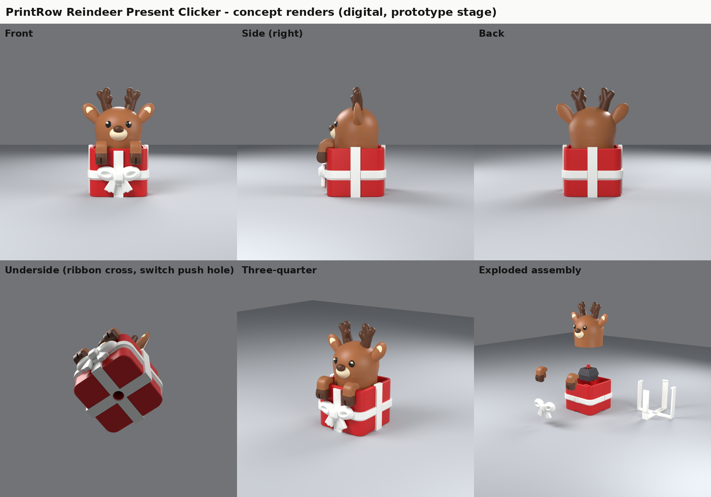

# PrintRow Reindeer Present Clicker (original design, prototype v0.1)

A cute reindeer peeking out of a wrapped present. **The head is the button.** It sits on a mechanical keyboard switch
like a keycap: press it down to click and it springs back. The front legs and hooves hang over the front rim and are
**fixed to the present**. Only the head and its socket move.

**Status: test-ready prototype.** Every check so far is digital (CAD, mesh and slicer software). Nothing has been printed yet.
**Not approved for sale, and not safety-approved.** No listing has been published.



## Print first
1. **Fit and movement test kit:** `exports/3mf/PrintRow_Reindeer_T_fit_and_movement_test_kit.3mf` (about 11.5 g, any colour).
   Follow section 0 of `docs/ASSEMBLY_SLICING_TESTING.md` and report the gauge numbers.
2. Once the switch fits: plates A (head), B (box), C (ribbon cage and bow) and D (legs). Assemble with no glue.

## Deliverables
| # | Request | Where |
|---|---|---|
| 1 | Front, side, back, underside concept renders | `renders/01_front*.png`, `02_side_right*`, `03_back*`, `04_underside*`, plus `05_three_quarter*` and `00_overview_sheet.png` |
| 2 | Cutaway / exploded view (fixed legs, moving head, switch, present) | `renders/06_cutaway_rest_labelled.png`, `07_cutaway_pressed_labelled.png`, `09_cutaway_leg_snap_labelled.png`, `08_exploded_labelled.png`, `clearance_sweep_plot.png` |
| 3 | Editable source files | `source/` (parametric Python: `params.py` is the single source of truth), `source/reindeer_character.blend` (Blender), `exports/step/*.step` (CAD B-rep for the box, ribbon cage and test parts; the head, bow and rounded legs are mesh models regenerated from the scripts) |
| 4 | Plain STL / plain 3MF with aligned colour parts | `exports/3mf/*.3mf` (plain core-spec 3MF), `exports/stl/product/*.stl` (fallback; colour STLs of a part share coordinates) |
| 5 | Small fit and movement test | `exports/3mf/PrintRow_Reindeer_T_fit_and_movement_test_kit.3mf`, `exports/stl/test_kit/` |
| 6 | Assembly, slicing and prototype-test instructions | `docs/ASSEMBLY_SLICING_TESTING.md` |
| + | Pre-sale checklist incl. safety review | `docs/PRE_SALE_CHECKLIST.md` |
| + | Switch identification and adjustable mount | `docs/SWITCH_NOTES.md` |
| + | What was verified, and how | `docs/VERIFICATION_REPORT.md`, `reports/` |
| + | Originality, third-party parts, tool licences | `docs/THIRD_PARTY_AND_LICENCES.md` |

## Key numbers (digital design values)
* Overall about 47 mm wide (ear tips) × 44 mm deep (bow to back) × 68 mm high. The present is 36 × 36 × 30 mm
  (38.7 mm across the ribbons). That is a little larger than the 33 × 33 × 64 mm starting reference, to fit the switch
  pocket, a 1 mm+ clearance gap all round, and thick antlers, ears and legs.
* Head travel 4.0 mm (MX). Clearance through the whole stroke: ≥ 1.06 mm to the box, 1.55 mm to the legs, 1.92 mm to the ribbon cage;
  0.75 mm worst case with a 1.5° off-centre tilt. Zero interference at every step.
* Printed parts: head, box, ribbon cage, bow, 2 legs. Plus 1 switch. No glue, screws or magnets.
* Net filament about 28 g (PrusaSlicer estimate, purge excluded; not Bambu Studio).

## Design decisions (and why)
* **Legs are separate snap-in parts fixed into thickened rim pads** (split tab with barbs, one-way). They never touch the head
  (≥ 1.5 mm). They print lying on their side, so the hook shape and tab run along the layers (strong) with no overhangs.
* **The ribbon is a separate white cage** (4 straps, rim caps, a cross under the box that sits flush in a bottom channel) plus a
  **white layer band on the box** (2 filament changes). Painting vertical ribbons with the AMS would mean a filament change on
  almost every layer of the box.
* **The bow prints flat** (best detail) and slides onto a dovetail rail on the front strap. Once the legs are fitted, the hooves stop it
  lifting off, so it is captured without glue.
* **The head mounts like a keycap** (5.5 mm boss, cross socket, keycap-style press fit), so the switch is replaceable.
  The cavity roof has 45° chamfers, and the chin, eyes and nose use 45° "hull" undersides, so the head prints upright without supports.
* **Short, thick antlers** (7.2 mm root, ≥ 4.4 mm tips, all segments ≥ 50° from horizontal) and thick-rooted ears tilted 50°.
* **The switch type is unconfirmed**, so the mount and socket are parametric and the test kit has gauges (see `docs/SWITCH_NOTES.md`).

## Colour and purge (important for cost)
The 4-colour head needs about 206–209 filament changes per plate. Purge can easily outweigh the head itself (PrusaSlicer's default
wipe tower used about 46 g for one head; Bambu's figure will differ). Print several heads per plate, use "flush into infill", or use the
3-colour option (eyes in dark brown, about 188 changes). Box: 2 changes. Legs: 0 if printed in one colour. Cage and bow: 0.

## Rebuild from source
```
python3.13 -m venv venv && venv/bin/pip install bpy==5.2.3 cadquery==2.8.0 manifold3d trimesh lib3mf lxml matplotlib scipy networkx rtree
sudo apt install prusa-slicer assimp-utils f3d xvfb   # independent checks (optional)
PY=venv/bin/python ./source/build_all.sh              # add --no-render to skip the Cycles renders
```
Pipeline: `mechanism_cq.py` (CadQuery) → `character_blender.py` (Blender) → `assemble.py` (colour split, socket,
clearance keep-out, exports) → `check_clearance.py` → `check_printability.py` → `estimate_colour_changes.py` →
`build_3mf.py` → `verify_exports.py` → `verify_multipart_prusaslicer.py` → PrusaSlicer and viewer checks →
`render_blender.py` → `label_renders.py`.

## Folder map
```
README.md                     this file
reference/                    owner-supplied visual reference (theme only, no geometry used)
source/                       editable sources + build scripts (params.py = all dimensions)
  reindeer_character.blend    Blender file of the character features and bow
  slicer/                     PrusaSlicer profile used only for the independent check
exports/3mf/                  plain 3MF per print plate + assembly preview (not for printing)
exports/stl/product/          print-oriented STL per part and colour (aligned)
exports/stl/test_kit/         fit and movement test STLs
exports/step/                 STEP of the CAD parts (box, cage, test parts)
renders/                      concept renders, cutaways, exploded view, clearance plot
reports/                      JSON/text results of every digital check, viewer screenshots
docs/                         instructions, checklist, switch notes, verification, licences
build/                        intermediate files (safe to delete; regenerated by build_all.sh)
```
